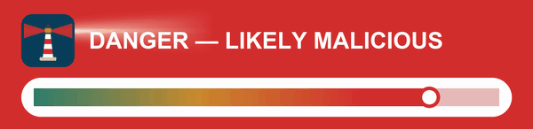
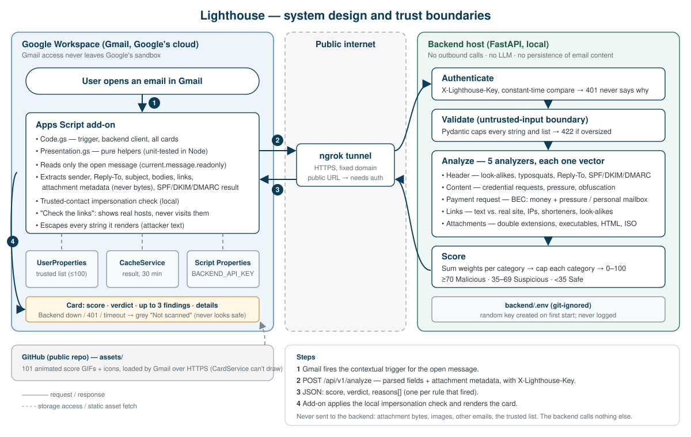

# Lighthouse — Smart Email Security (Gmail Add-on)

Lighthouse is a Gmail add-on that scores the email you have open from 0 to 100, gives a clear verdict
(**Safe**, **Suspicious** or **Malicious**) and explains *why* in plain language. A small FastAPI backend
does the analysis with explainable, local heuristics: no email content is sent to any analysis service,
reputation lookup or LLM (the demo's tunnel is the one third party in the path; see [Security](#security)).

<p align="center"></p>

**At a glance**

- **Explainable by design.** Every point of the score comes from a named rule with a human-readable reason.
- **24 detection rules** across sender identity, wording, payment requests (CEO / vendor fraud), links and
  attachments, plus a personal check against *your* trusted contacts.
- **Least privilege.** The add-on can read only the message that is open, never the mailbox.
- **Measured blind, twice.** On a fresh 50-email holdout written by a separate model that never saw the
  rules: 7 of 20 malicious emails caught, 1 of 30 legitimate emails flagged. Strong where rules exist
  (malware delivery 3/4, known brands 3/4), weak where they don't (phishing without a brand 0/4)
  ([details](#evaluation)).
- **Tested.** 160 backend tests, 59 add-on tests, 7 asset-generator tests.

## Contents

1. [Product thinking](#product-thinking)
2. [Architecture](#architecture)
3. [What the user sees](#what-the-user-sees)
4. [How detection works](#how-detection-works)
5. [Security](#security)
6. [Key decisions and trade-offs](#key-decisions-and-trade-offs)
7. [Evaluation](#evaluation)
8. [Run it yourself](#run-it-yourself)
9. [Repository layout](#repository-layout)
10. [Known limitations](#known-limitations)
11. [Roadmap](#roadmap)

## Product thinking

**Who it's for.** Everyday Gmail users with no security background: people reading their own mail who
need a clear answer to "is it safe to act on this?", not an analyst triaging alerts.

**The problem we designed against.** Email warnings tend to fail in two ways:

- **A verdict without a reason** ("Suspicious, 62"). The user can't judge it, so they either ignore it or panic.
- **An alarm that rings too often.** After a few false alarms people stop reading warnings, including the real one.

**The name and the voice.** A lighthouse doesn't shout at every ship. It is a steady light that becomes a
warning only near real rocks. That sets the tone: calm and plain-spoken by default, loud only when the risk
is real.

**Principles, and the decisions they led to**

| Principle | What it led to |
|---|---|
| **Explain, don't just score** | Every point comes from a named rule. Findings are one-line labels in plain language ("Link goes somewhere else"), with the evidence one tap away in View details. |
| **Loudness matches risk** | Safe email gets a quiet green card with no findings listed; amber shows at most three; only Malicious turns red, with one clear instruction. |
| **The red alarm must be trusted** | Rules favour precision over coverage. When the first evaluation showed misses, the fix was new signals, not a lower threshold (see [Evaluation](#evaluation)). |
| **Respect a non-expert's attention** | Rule names never reach the user; repeated findings are merged ("×2"); "Check the links" shows where every link really goes on one screen. |
| **Never make things worse** | Links are never visited; "Not scanned" never looks safe; a trusted sender is still scanned; no button that pretends to do something. |
| **Privacy is part of trust** | The narrowest Gmail scope, no email content sent to analysis services, and the trusted list never leaves Google. |

**Deliberately left out:** acting on the mailbox (moving to spam, deleting), which would need full mailbox
access; blocking or hiding mail, which takes the decision away from the user; and an "AI says" verdict
that can't explain itself.

## Architecture



| Add-on (Apps Script, runs in Google's cloud) | Backend (FastAPI, runs on our host) |
|---|---|
| Reads **only the open message** and extracts sender, Reply-To, subject, bodies, links (visible text and real target) and attachment **metadata**, never file bytes. | Treats every field as attacker-controlled: request models cap every string and list, so oversized input is rejected with `422`. |
| Owns everything that needs Gmail context or user data: trusted senders, caching, the "Check the links" card, the trusted-contact impersonation check, all UI. | Owns all scoring: five analyzers, each looking at one part of the email, and an aggregator that caps each category. Pure Python, unit-tested. |
| Escapes every string it renders, because finding descriptions quote attacker text. | Never fetches, executes or renders its input. No third-party lookups, no LLM, no persistence. |
| Any failure (backend down, `401`, timeout, bad JSON) shows a grey **Not scanned** card, which never looks safe. | Shared-secret authentication, compared in constant time; a rejection never says why. |

**Why this split.** It follows the data. Gmail access stays inside Google's sandbox with the narrowest
scope, and the part that needs real engineering (rules, tests, fast iteration) lives in an ordinary Python
service. The contact list never leaves Google, so the check that needs it runs in the add-on.

## What the user sees

The card's loudness matches the risk: safe email stays quiet so a dangerous one can stand out.

| Verdict | Card |
|---|---|
| **Safe** (0–34) | Green band with the score and a check strip (✓ Sender · ✓ Message · ✓ Links · ✓ Files). No findings listed. |
| **Suspicious** (35–69) | Amber band, the check strip, and up to three one-line findings ("Link goes somewhere else"). |
| **Malicious** (70+) | Red band, bold red "Do not click links or open attachments", a red **View why this is dangerous** button and **Report this email**. |
| **Trusted sender** | Calm green card with risk 0, unless the scan says Malicious: then the red card appears anyway. |
| **Not scanned** | Grey card: "use your usual caution". Never looks like a safe result. |

The band at the top is an animated lighthouse beam that sweeps twice and stops. Below it:

- **View details** groups every finding by category, each with a plain-language explanation and the
  technical evidence (the actual domains, file names, phrases), followed by "What we checked" so a clean
  result is not an empty screen.
- **Check the links** lists every web link with the site it *really* opens, flagging text that names a
  different site, numeric addresses, look-alike letters and shorteners. It reads the links from the open
  message only: **Lighthouse never visits them**, and the card says it shows where a link goes, not
  whether the site is safe.
- **Trust sender** (non-malicious cards) adds the full address to a private list. A trusted sender is
  **still scanned**, because sender addresses can be forged. Free-mail domains (gmail.com, …) can never be
  trusted as a whole. The list (⋮ → Trusted senders, max 100) also powers the impersonation check below.
- **Report this email** opens Google's reporting instructions. Reporting in place would need
  `gmail.modify`, which we deliberately do not request.

There is deliberately no "this is a mistake" button: an earlier version had one that showed "thanks,
this helps calibrate" and recorded nothing, which is an empty promise. A real feedback loop is in the
[Roadmap](#roadmap).

## How detection works

### Scoring in one minute

1. Each **rule** that fires adds its **weight** to its **category** (sender, content, links, attachments).
2. Each category is **capped**, so many weak signals in one place can't decide the verdict alone.
3. The capped categories are **added up** (0–100): **70+ Malicious**, **35–69 Suspicious**, below 35 Safe.

Independent signals from *different* categories add up; a pile of signals in *one* category doesn't. That
mirrors how an analyst reasons: one odd link proves little, but an odd sender *and* a password request
*and* a misleading link is a phishing email.

**Worked example** (a real run of the engine): display name "PayPal Security", sent from
`paypa1-support.com`, body "Please verify your account within 24 hours", link text `paypal.com/login`
pointing to `paypa1-support.com`.

| Category | Rule that fired | Points | Category cap |
|---|---|---|---|
| Sender | Name says PayPal, domain isn't PayPal's | 35 | 50 |
| Content | Asks the reader to verify their account | 15 | 35 |
| Links | Text shows paypal.com, link opens another site | 25 | 40 |
| **Total** | | **75 → Malicious** | |

No single signal reaches 70; together, from three categories, they do.

### The rules

Weights in parentheses. "Once" means the rule counts at most once per email.

**Sender identity** (cap 50)

| Rule | Fires when |
|---|---|
| `typosquat_domain` (40) | The sender claims a known brand from a look-alike domain (`paypa1.com`). |
| `display_name_domain_mismatch` (35) | The name or address claims a known brand, but the domain is not one of that brand's. |
| `payment_request_unverified_sender` (35) | A request for money or new payment details comes from a free-mail address, or replies go to one. |
| `reply_to_mismatch` (15) | Replies would go to a different domain than the sender's. |
| `spf_fail`, `dkim_fail`, `dmarc_fail` (20 each) | Authentication headers report a failure. *Cannot fire today*: see [limitations](#known-limitations). |
| `trusted_contact_impersonation` (40) | *Runs in the add-on.* An untrusted sender poses as someone on your trusted list: the display name shows a trusted address, or the domain is a near-copy of a trusted contact's (`acmec0rp.com`). |

**Message content** (cap 35)

| Rule | Fires when |
|---|---|
| `payment_request_pressure` (35) | A request for money or new payment details (gift cards, wire transfer, changed bank or payroll details) comes with pressure or secrecy ("urgent", "I'm in a meeting", "keep this confidential"). |
| `credential_request_language` (15, once) | The email asks the reader to verify, confirm or enter login or payment details. |
| `urgency_financial_proximity` (20, max 2) | An urgency phrase appears within ~120 characters of a money or credential term. |
| `base64_obfuscation` (25) | The body contains a long encoded block. |
| `html_entity_obfuscation` (20) | Ordinary letters are spelled as HTML codes (`&#112;&#97;&#121;` = "pay") to slip past keyword filters. |
| `excessive_url_encoding` (15) | The body contains 10+ `%XX` encoded sequences. |

**Links** (cap 40)

| Rule | Fires when |
|---|---|
| `link_text_href_mismatch` (25, max 2) | The link text shows one site, but the link opens another. |
| `ip_literal_host` (20) | A link points to a numeric address instead of a site name. |
| `punycode_lookalike_domain` (20, once) | A link uses letters from another alphabet that can look like a familiar name (`раураl.com`). |
| `high_entropy_domain` (15) | A link's domain looks randomly generated. |
| `url_shortener` (10) | A link hides its destination behind a shortener. |
| `suspicious_tld` (10, once) | A link's domain ends in a suffix commonly abused for phishing (`.top`, `.xyz`, `.zip`, …). |

**Attachments** (cap 50)

| Rule | Fires when |
|---|---|
| `double_extension` (45) | A file is disguised with two extensions (`invoice.pdf.exe`). |
| `macro_enabled_with_pressure_context` (45) | A macro-enabled Office file arrives with urgent or money-related wording. |
| `dangerous_extension` (35) | A file that can run code or open a fake login page: programs and scripts, HTML, disk images (`.iso`, `.img`), shortcuts (`.lnk`), OneNote. |
| `macro_enabled_attachment` (20) | A macro-enabled Office file. |

### Guards against false alarms

Each of these came from a real false positive or a test case, and each has a regression test:

- **A brand's own subdomains are the brand.** `members.netflix.com` is Netflix; `netflix.com.evil.example` is not.
- **Links are compared by site, not by exact host.** `www.` or `links.` of the same site is fine. On shared
  hosting (`github.io`, `web.app`, …) each subdomain is a separate site, so `mybank.github.io` vs
  `evil.github.io` is still a mismatch.
- **Newsletter click trackers are not mismatches.** Mailchimp, SendGrid and similar services wrap every
  link in legitimate newsletters.
- **An email address in link text is not a site.** "Mailed to you@gmail.com" linking to netflix.com is normal.
- **Typographic HTML codes don't count as obfuscation.** Spaces, quotes and dashes are in every rich email.
- **Payment-fraud pressure words are not marketing words.** "Buy a gift card today!" from a store does not fire.
- **A bare mention of "password" is not a request.** "You changed your password" does not fire.

## Security

**Least privilege.** `appsscript.json` requests only three scopes:

| Scope | Why |
|---|---|
| `gmail.addons.execute` | Required for any Gmail add-on to run. |
| `gmail.addons.current.message.readonly` | Read **only the message the user has open**: never the inbox, never other threads. |
| `script.external_request` | Call our backend. |

No `gmail.readonly`, no `gmail.modify`. If the add-on misbehaves, the blast radius is one open email.

**Untrusted input.** Every field comes from an email, so every field is attacker-controlled:

- The backend's request models bound every string and list; oversized payloads are rejected (`422`).
- Nothing is executed, rendered or fetched. Rules are plain pattern matching.
- The add-on escapes and truncates everything it shows, including the backend's descriptions, which quote
  attacker text.
- Attachments are metadata only (name, type, size). Links are never visited.

**Secrets and authentication.** The backend is reachable through a public tunnel and this repository is
public, so it must not answer strangers (flooding, or using it as a free oracle to tune evasive emails).

- The add-on sends an `X-Lighthouse-Key` header. The key lives in Apps Script **Script Properties**
  (`BACKEND_API_KEY`), never in the source.
- On first start the backend creates `backend/.env` (git-ignored) with a random key and prints where to
  find it; the key itself is never logged.
- The key is compared in constant time; a wrong or missing key gets `401` with a body that never says why.
- API docs (`/docs`, `/openapi.json`) are off by default so the schema isn't published to strangers.

**Privacy.** No email content goes to analysis services: no URL reputation, no LLM APIs, and the backend
makes no outbound calls. The trusted-contact list never leaves Google.

**The one third party in the path (demo setup).** The add-on reaches the backend through an ngrok tunnel,
and ngrok terminates TLS on its own servers, so it can technically see the fields being scanned. That is
acceptable for a demo on test mail, and it is stated here rather than hidden. In production the backend would
run on infrastructure we control (for example Cloud Run, in the same cloud as the add-on), reached over TLS
end to end and authenticated with a Google-signed identity token instead of a static key.

Results are cached for 30 minutes in the user's own `CacheService` so the details card doesn't need a
second scan.

## Key decisions and trade-offs

| Decision | Why | What it costs |
|---|---|---|
| **Explainable heuristics, not ML or an LLM** | Every point maps to a named rule with a readable reason. Offline, deterministic, testable. | Misses novel phrasing a model might catch. Weights are hand-tuned, not learned. |
| **Nothing leaves the backend** | Email content is sensitive; third-party lookups are a privacy and compliance risk. | No knowledge of known-bad URLs or domain age. |
| **Narrowest Gmail scope** | Blast radius of a bug or compromise is one open email. | The add-on can't read raw headers, so the SPF/DKIM/DMARC rules can't fire today. |
| **Per-category caps** | Many weak signals in one category shouldn't alone mean Malicious; independent ones should add up. | A truly single-category attack can stay below 70. |
| **Impersonation check in the add-on** | It needs the trusted list, which should never leave Google. | A small piece of scoring lives in JS; a test keeps its thresholds equal to the backend's. |
| **Trusted senders are still scanned** | A forged "trusted" address must not be a free pass. | One backend call even for known senders. |
| **"Check the links" never visits a link** | Visiting fires tracking pixels and can trigger exploits. | Shows where a link goes, not whether the site is safe; the card says so. |
| **High precision on the red alarm** | Users ignore a tool that cries wolf; in a real inbox most mail is legitimate. | Some attacks get amber instead of red, or are missed (see Evaluation). |
| **Pre-rendered images and GIFs** | Gmail cards can't draw graphics or run code; images are the only way to show a gauge or animation. | 101 GIFs (~17 MB) in the repo; changing thresholds means regenerating them. |
| **Shared secret + ngrok** | Simple, and keeps strangers off a public tunnel. | Static key, no rate limiting, and ngrok terminates TLS so it sits in the data path; production would self-host and use a Google-signed identity token. |

## Evaluation

Two sets of **50 emails each (30 legitimate, 20 malicious), written by a separate model (Gemini) that was
told nothing about the rules**. Each blind run happened once, before any change based on it. Run with
`python eval/run_eval.py` (development set) or `python eval/run_eval.py --samples "eval/holdout/*.json"`
(holdout) from `backend/`. Full write-up (Hebrew):
[docs/Lighthouse_Evaluation_Report_HE.docx](docs/Lighthouse_Evaluation_Report_HE.docx).

| Blind run | Malicious caught (of 20) | Legitimate flagged (of 30) | Reached Malicious |
|---|---|---|---|
| 1. Development set (`eval/raw/`), first version of the rules | 10 (50%) | 0 (0%) | 3 |
| 2. Holdout (`eval/holdout/`), current rules, never tuned on it | **7 (35%)** | **1 (3%)** | 3 |

### Run 1: what we learned, and what we did about it

- **The misses were a coverage gap, not a threshold problem.** 6 of the 10 misses scored 0: no rule fired
  at all. Lowering the threshold to 15 would have caught 4 more at the cost of 7 false alarms. The fix was
  new signals: payment fraud with no links, and HTML / disk-image attachments.
- **After that, this set became a development set, not a test set.** The new rules were written after
  seeing these misses, so re-running them here proves little and is *not* reported as a detection rate.
  It was used only as a regression check: the re-run changed no legitimate email's score.
  (`results_dev_blind.json` is the blind run, `results_dev_rerun.json` the re-run, `results_holdout.json` run 2.) Measuring the new rules
  needs a fresh set they were not designed on.

### Run 2: the holdout

The holdout was **deliberately weighted toward the weak spots run 1 exposed**, and contains hard
legitimate cases (a manager approving a transfer, an invoice whose replies go to Yahoo, friends talking about
money). It is a stress test, not a sample of a normal inbox. By batch:

| Batch | Malicious emails | Caught |
|---|---|---|
| Brand impersonation | look-alike Netflix, Amazon, DocuSign, Expedia | 3 of 4 |
| Malware delivery | `.iso`, `.html`, `.zip` attachments, `.msi` link | 3 of 4 |
| Invoice and payment fraud | CEO wire transfer, vendor bank change, fake invoices | 1 of 4 |
| Phishing without a brand | "mail administrator", "system verification", fake internal IT | 0 of 4 |
| Personal-mail scams | "client gifts" CEO request, phone-call refund scam, postal fee, fake quarantine login | 0 of 4 |

- **What generalized:** the new rules caught attack types they had never seen in that form: the disk-image
  and HTML-smuggling attachments, and a CEO wire-transfer request from a Gmail address (70, Malicious).
  Known-brand impersonation held up. (The `.zip` invoice was caught by its pressure wording, not the file:
  `.zip` is not on the risky list.)
- **What didn't:** impersonation of brands outside the list of 12 (Expedia, Atlassian, Israel Post); generic
  authority impersonation; rephrased payment fraud ("client gifts", "has updated our banking details");
  phone-call scams with no link; a malicious installer behind a link rather than attached.
- **The one false alarm** was a genuine PayPal email from `paypal.co.il`: the brand list knows only
  `paypal.com` and `paypal.co.uk`, so the Israeli domain looked like a look-alike. **Fixed after the run**:
  official regional domains of PayPal and Amazon are now listed explicitly (never `paypal.<anything>`, so
  `paypal.tk` is still caught). The holdout numbers above were measured *before* this fix and are left as is.
- **`reply_to_mismatch` fired on 8 legitimate emails and 0 malicious ones** in the holdout: as a standalone
  signal it is noise.
- **The lesson:** rule-based detection is precise but narrow. It catches the patterns it was written for and
  misses paraphrases and unlisted brands, which only a set the rules were never tuned on can show.

### Real mail

- **Zero false alarms is optimistic.** LLM-written mail is cleaner than real mail. One day of use on a real
  inbox flagged three legitimate emails: a Mailchimp newsletter (a Reply-To parsing bug and newsletter click
  trackers), a vendor welcome email (typographic HTML codes) and a Netflix email (a brand subdomain, and an
  email address in link text). Each cause is fixed and has a regression test; the Netflix email can still
  reach Suspicious from its marketing HTML.

## Run it yourself

Requirements: Python 3.12 (what it was tested with), Node 18+ (only for the add-on tests), a Google account, and a way to expose
the backend over HTTPS (we use [ngrok](https://ngrok.com)).

**1. Backend**

```powershell
cd backend
python -m venv .venv
.venv\Scripts\activate                 # macOS/Linux: source .venv/bin/activate
pip install -r requirements.txt
uvicorn main:app --reload --port 8000  # first start creates backend/.env with a random API key
```

**2. Tunnel** (Apps Script runs in Google's cloud and can't reach `localhost`)

```powershell
ngrok http 8000                        # or, with a reserved domain: ngrok http 8000 --url=https://<your-domain>
```

**3. Add-on**

1. Push `Code.gs`, `Presentation.gs` and `appsscript.json` to an Apps Script project (`clasp push` with the
   included `.clasp.json`, or paste them into [script.google.com](https://script.google.com)).
2. In `Code.gs`, set `BACKEND_URL` to `https://<your-tunnel>/api/v1/analyze`.
3. Project Settings → Script Properties: add `BACKEND_API_KEY` with the value from `backend/.env`.
4. **Deploy → Test deployments → Install**, then open any email in Gmail.

**Tests**

```powershell
# backend: 160 tests (from backend/, with the virtual environment active)
pip install -r requirements-dev.txt
pytest
python eval/run_eval.py          # evaluation on the 50-email set

# add-on: 59 tests (from the repository root)
node --test tests/presentation.test.js tests/code_smoke.test.js

# asset generator: 7 tests (from the repository root)
pip install -r tools/requirements.txt
python -m unittest discover -s tools/tests
```

## Repository layout

```
.
├── appsscript.json        Add-on manifest: scopes, triggers
├── Code.gs                Add-on: trigger, backend client, all cards and actions
├── Presentation.gs        Add-on: pure helpers (labels, link inspector, impersonation check), tested in Node
├── tests/                 Node tests for Presentation.gs and a card-building smoke test
├── backend/
│   ├── main.py            FastAPI app: authentication, /api/v1/analyze, /health
│   ├── models.py          Request/response models: the untrusted-input boundary
│   ├── analyzer.py        The five analyzers and the scoring engine
│   ├── config.py          API key creation and loading (backend/.env)
│   ├── tests/             Unit and API tests
│   └── eval/              Independent 50-email test set, runner and results
├── assets/                Generated card images (animated score GIFs, icons), served from GitHub
├── tools/                 generate_assets.py (regenerates assets/) and its tests
└── docs/                  System design diagram, evaluation report
```

## Known limitations

- **No SPF/DKIM/DMARC.** The add-on's scope can't read raw headers, so these rules exist but can't fire.
- **No URL reputation.** A deliberate privacy choice: nothing leaves the backend.
- **Known brands are a fixed list of 12.** Impersonation of an unlisted brand is caught only by other signals.
- **"Same site" uses a small built-in suffix list**, not the full Public Suffix List.
- **QR codes (quishing) are not decoded.** Images are never sent to the backend, by design.
- **No mailbox actions** (label, move to spam): they need `gmail.modify`.
- **The tunnel is a third party in the data path.** ngrok terminates TLS, so it could see scanned fields.
  Fine for a demo; production would self-host the backend (see [Security](#security)).
- **One static API key**, no rate limiting or rotation yet.
- **The tunnel URL is set by hand** in `Code.gs`.
- **Changing the verdict thresholds** means regenerating the card images (`python tools/generate_assets.py`).
- **Apps Script has no configurable request timeout**, so a very slow backend is bounded by the platform's
  own execution limits rather than an app-level timeout.

## Roadmap

Where a rule exists, it held up on data it had never seen (known brands 3/4, malware delivery 3/4 on the
blind holdout); the misses are attack types with no rule yet. So the next step is **more coverage, each new
rule measured on a fresh holdout**, not tuning the rules we have. What the holdout points to, in order:

- **Brands beyond a fixed list.** Regional domains of every listed brand (done for PayPal and Amazon after
  the holdout), and brands outside the list, via a maintained brand-domain list or domain-age / reputation data.
- **Phishing without a brand.** Detect generic authority impersonation ("IT Helpdesk", "Mail Server
  Administrator") from outside or free-mail domains.
- **Payment fraud by meaning, not phrases.** A small classifier for BEC wording instead of regular
  expressions, and phone-call (callback) scams with no link.
- **Executables behind links.** Apply the risky-file check to link targets (`.msi`, `.exe`), not only attachments.
- **Measure on real mail.** Public phishing corpora and real legitimate mail, and a fresh holdout for every
  round of rule changes.
- **QR codes.** Decode QR images on the backend and send the extracted link through the existing link rules.
- **SPF/DKIM/DMARC** from message headers, if a broader scope is acceptable.
- **A real feedback loop.** "Which of these is wrong?" lets the user mute only the wrong findings, only for
  that sender (identity checks can never be muted). The backend keeps counts only, so per-rule false-alarm
  rates become visible to the operator without storing email content.
- **Backend hardening.** Rate limiting, key rotation, and a Google-signed identity token instead of a static key.
