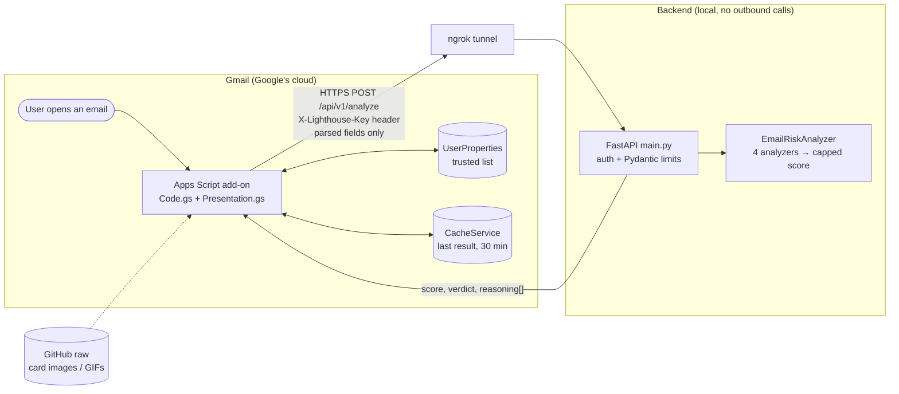

# Lighthouse - Smart Email Security — Gmail Add-on

A Google Workspace Gmail Add-on (built with `CardService`) that scans the
currently open email against the local FastAPI backend (see `/backend`)
and shows the user a maliciousness score, verdict, and reasoning.

## Design principles

1. **Explainable** — every verdict comes with the evidence behind it, not just a number.
2. **Loudness is calibrated** — safe email stays quiet so a dangerous one can shout. The card
   escalates through an intensity ladder:

   | State | What the user sees |
   |---|---|
   | Safe | Green hero block with the score, nothing else |
   | Suspicious | Amber hero block with the score and one plain-language finding |
   | Malicious | Red hero block with the score, bold red "What to do", filled red button, solid-red gauge above 90 |
   | Not scanned | Grey card — "This email wasn't scanned, use your usual caution" (never implies safety) |

3. **Privacy first** — all analysis is local heuristics; no email content goes to third-party services.
4. **Least privilege** — see the scopes below.
5. **Plain headlines, warm voice** — headlines and findings are direct; the Lighthouse personality
   lives in subtitles and explanatory copy.

The lighthouse icon changes beam color with the verdict, and the gauge fades green → amber →
red along the backend's thresholds (35 suspicious, 70 malicious).

## Architecture



**Who does what, and why**

| Add-on (Apps Script) | Backend (FastAPI) |
|---|---|
| Reads **only the open message** (`current.message.readonly`) and extracts sender, Reply-To, subject, bodies, links (text + href) and attachment **metadata** — never file bytes. | Treats every field as attacker-controlled: Pydantic caps every string and list, so oversized payloads get `422`. |
| Trusted senders, caching, the "Check the links" inspector and all UI. These need Gmail context or user data, which never leave Google. | All scoring: four single-vector analyzers plus a per-category-capped aggregator. Pure Python, unit-tested, easy to extend. |
| Escapes everything it renders (`safeText`), because finding descriptions quote attacker text. | Never fetches, executes or renders input. No third-party lookups, no LLM, no persistence. |
| Any failure (backend down, `401`, timeout, malformed JSON) shows a grey **Not scanned** card, which never looks safe. | Shared-secret auth in constant time; a rejection never says why. |

The split follows the data: Gmail access stays in Google's sandbox with the narrowest scope, and the
part that needs real code (rules, tests, iteration) lives in a normal Python service.

## Security posture: principle of least privilege

`appsscript.json` requests only the three scopes strictly required:

| Scope | Why |
|---|---|
| `gmail.addons.execute` | Required for any Gmail add-on to run at all. |
| `gmail.addons.current.message.readonly` | Lets the add-on read **only the single message the user currently has open** — never the inbox, never other threads. |
| `script.external_request` | Required for `UrlFetchApp` to call our own local backend. |

We deliberately do **not** request `gmail.readonly`, `gmail.modify`, or any
broad mailbox scope. If this add-on is compromised or misbehaves, the
blast radius is a single opened email, not the user's whole mailbox.

## Files

```
.
├── appsscript.json         Manifest: oauth scopes, contextual trigger, homepage trigger
├── Code.gs                 Add-on logic (CardService UI + backend client)
├── Presentation.gs         Pure helpers: state -> hero image/copy, top finding, escaping, link inspector (unit-tested in Node)
├── assets/                 Generated: 4 icons + one color-band image per score 0-100, animated GIF (served via GitHub raw)
├── tools/generate_assets.py  Regenerates /assets  (python tools/generate_assets.py)
├── tests/                  Node tests for Presentation.gs and a CardService smoke test
├── backend/                FastAPI service: main.py (API + auth), models.py (input limits), analyzer.py (rules) — see backend/README.md
└── docs/                   Design spec, implementation plan, demo script
```

Images in Gmail cards must come from a public HTTPS URL, so the PNGs are committed and loaded from
`raw.githubusercontent.com` (`ASSET_BASE_URL` in `Code.gs`; the repository must be public).
Run the tests with `node --test tests/presentation.test.js tests/code_smoke.test.js` and
`python -m unittest discover -s tools/tests`.

## How it works

1. **Message opened** → `buildAddOn(e)` fires (the `gmail.contextualTriggers`
   unconditional trigger). It reads the access token/message id Gmail hands
   it, and uses `GmailApp.getMessageById` to read sender, subject, body, and
   links from the **currently open message only**.
2. **Backend call** — `callBackend()` POSTs the parsed fields to `BACKEND_URL`
   (`/api/v1/analyze`) wrapped in try/catch. Any network error, timeout, or
   malformed/non-2xx response renders the grey **Not scanned** card instead of a
   stack trace. Trusted senders (user whitelist in `PropertiesService`) are
   **still scanned**: a spoofed "trusted" address must not bypass the checks. They
   get the calm "A familiar face" card only when the verdict is Safe.
3. **Result card** — deliberately quiet. A full-width **color band** (one pre-rendered
   PNG per score, 0-100: verdict color, headline, green-to-red gauge) leads, followed by the score as
   native text, a compact check strip (✓ Sender · ⚠ Message · ✓ Links · ✓ Files) and up to three
   plain-language findings. A "What to do" line (malicious only) and one button (**View details**; red when malicious, plus **Report this email**,
   which opens Google's reporting instructions — reporting in place would need `gmail.modify`,
   which we deliberately do not request). **Trust this sender** and **I think this is a mistake**
   live in the card's overflow menu (⋮). The hero's colors mirror the backend thresholds (35, 70);
   if those change, re-run `tools/generate_assets.py`.
4. **Details card** — "View details" uses
   `CardService.newNavigation().pushCard()`, which triggers Gmail's native
   slide-in card animation, to reveal the full per-rule reasoning (grouped
   by category, each rephrased into a warm "wise guide" sentence via
   `RULE_WISDOM`) that was deliberately hidden from the main card to avoid
   overwhelming the user, followed by a "What we checked" list so a clean
   result is not an empty screen.
5. **Check the links** — a button that opens a card listing every web link in the email: the real
   host in bold, and what the link text claimed. It flags text that names a different site
   (including the `paypal.com.evil.example` subdomain trick), numeric hosts, look-alike (punycode)
   hosts and link shorteners. Links routed through a newsletter service's click tracker (Mailchimp,
   SendGrid, …) get a neutral ℹ row instead of a red one, and are not counted as suspicious. It runs entirely from the links already in the open message: **the
   Lighthouse never visits them** (no privacy leak, no tracking pixels fired), and the card says so.
   It shows where a link points, never "this link is safe".
6. **Feedback** — "I think this is a mistake" returns an
   `ActionResponseBuilder` with `setNotification(...)`, showing a toast
   ("Thank you! Your feedback helps calibrate the Lighthouse.") without
   navigating away.

## How scoring works

The backend (`backend/analyzer.py`) runs four analyzers. Every rule that fires adds its weight to its
category; each category is then capped, so one noisy vector can't decide the verdict alone, while
independent signals across vectors still add up. The capped totals are summed and clamped to 0-100:
**70+ = Malicious**, **35-69 = Suspicious**, below 35 = Safe.

Category caps: `header` 50 · `content` 35 · `link` 40 · `attachment` 50.

| Rule | Category | Weight | What it catches |
|---|---|---|---|
| `typosquat_domain` | header | 40 | Sender claims a known brand from a look-alike domain (`paypa1.com`) |
| `display_name_domain_mismatch` | header | 35 | Display name/address names a brand, but the domain isn't one of its domains |
| `trusted_contact_impersonation` | header | 40 | **New, runs in the add-on.** An untrusted sender poses as someone on *your* trusted list: the display name shows a trusted address, or the domain is a near-copy of a trusted contact's (`acmec0rp.com`, `acme-corp.com`). Free-mail domains are never compared |
| `reply_to_mismatch` | header | 15 | Reply-To domain differs from the From domain |
| `spf_fail` / `dkim_fail` / `dmarc_fail` | header | 20 each | `Authentication-Results` reports a failure (see Known limitations) |
| `urgency_financial_proximity` | content | 20 (max 2) | Urgency phrase within ~120 chars of a money/credential term |
| `credential_request_language` | content | 15 | **New.** Asks the reader to hand over login or payment details: an action verb followed by a credential noun ("verify your account", "confirm your password", "sign in to continue", "update your billing details"). A bare mention of "password" ("you changed your password") does not fire. Once per message |
| `base64_obfuscation` | content | 25 | Long base64 blob in the body |
| `excessive_url_encoding` | content | 15 | 10+ `%XX` sequences |
| `html_entity_obfuscation` | content | 20 | 6+ `&#x..;` entities in the HTML body |
| `link_text_href_mismatch` | link | 25 (max 2) | Link text shows one domain, the link goes to another. Links through mainstream newsletter click trackers (`LinkAnalyzer.ESP_CLICK_TRACKERS`: Mailchimp, SendGrid, …) are exempt, since legit newsletters wrap every link that way |
| `ip_literal_host` | link | 20 | Link to a bare IP address |
| `url_shortener` | link | 10 | Known shortener hides the destination |
| `high_entropy_domain` | link | 15 | Random-looking (DGA-style) domain label |
| `punycode_lookalike_domain` | link | 20 | **New.** A link host with punycode (`xn--`) or raw non-Latin letters, the homograph trick (`раураl.com` in Cyrillic). Alone it stays below Suspicious, since real non-Latin domains exist. Once per message |
| `suspicious_tld` | link | 10 | **New.** A link's host ends in a TLD commonly abused for phishing (`LinkAnalyzer.SUSPICIOUS_TLDS`: `.top .xyz .click .gq .tk .ml .cf .ga .zip .mov .work .rest .support`). Normal TLDs (`.com`, `.org`, `.io`, `.co.il`, …) never fire. Once per message |
| `double_extension` | attachment | 45 | `invoice.pdf.exe` |
| `dangerous_extension` | attachment | 35 | Executable/script attachment (`.exe`, `.js`, …) |
| `macro_enabled_with_pressure_context` | attachment | 45 | Macro Office file plus urgency/financial wording |
| `macro_enabled_attachment` | attachment | 20 | Macro-enabled Office file |

Every rule also has a one-line card label (`RULE_SHORT_LABELS` in `Presentation.gs`) and a longer
details-card sentence (`RULE_WISDOM` in `Code.gs`).

## Key decisions & trade-offs

| Decision | Why | What it costs |
|---|---|---|
| **Explainable heuristics, not ML or an LLM** | Every point on the score maps to a named rule with a reason the user can read. Runs offline, deterministic, testable. | Misses novel phrasing a model might catch. Weights are hand-tuned, not learned. |
| **Nothing leaves the backend** (no URL reputation, no sandboxing, no LLM API) | Email content is sensitive; sending it to third parties is a privacy and compliance risk. | No knowledge of known-bad URLs or domain age. |
| **Narrowest Gmail scope** (`current.message.readonly`) | Blast radius of a bug or compromise is one open email. | The add-on cannot read raw headers, so the SPF/DKIM/DMARC rules exist but cannot fire today. |
| **Per-category caps** (header 50, content 35, link 40, attachment 50) | Many weak signals in *one* vector should not alone mean "Malicious"; independent vectors should add up. | A truly single-vector attack (e.g. only a credential lure) can stay below 70. |
| **Impersonation check runs in the add-on** | Comparing senders against the user's trusted list needs that list; keeping the check client-side means the contact list never leaves Google. | A small piece of scoring lives in JS (adds 40, recomputes the verdict). A test keeps its thresholds equal to the backend's. |
| **Trusted senders are still scanned** | A forged "trusted" From must not be a free pass; a Malicious verdict overrides trust. | One backend call even for known senders. |
| **"Check the links" never visits a link** | Visiting fires tracking pixels and can trigger exploits. | Shows where a link points, not whether the site is safe; says so on the card. |
| **Pre-rendered images and GIFs** | `CardService` cannot draw custom graphics or run code; images are the only way to show a gauge or animation. | 101 GIFs (~17 MB) in the repo; changing thresholds means regenerating them. |
| **Shared secret + ngrok for the demo** | Simple, keeps strangers off a public tunnel. | Static key, no rate limiting; production would use a Google OIDC identity token. |

**Iterating on real mail.** Testing on a real inbox surfaced a false positive: a Mailchimp newsletter
scored 70 (Malicious). Two causes. Reply-To arrived as `Name <info@tlvsalon.com>`, so the domain parsed
as `tlvsalon.com>`. And every newsletter link goes through a click tracker (`us.list-manage.com`), so it
looked like a text/href mismatch. Both are fixed and covered by a regression test that rebuilds that
email (now Safe). The lesson is in the Roadmap: build a labelled set of real mail to measure the
false-positive rate before tuning weights further.

## Setup & local testing

The backend runs locally; Apps Script executes in Google's cloud and
cannot reach `localhost` directly, so you need a tunnel:

```powershell
# 1. Start the backend (see /backend/README.md)
cd backend
uvicorn main:app --reload --port 8000

# 2. In a second terminal, expose it publicly
ngrok http 8000
# -> copy the printed https://xxxx.ngrok-free.app URL
```

Then:

1. Open [script.google.com](https://script.google.com), create/open the
   Apps Script project (or use `clasp push` with the existing
   `.clasp.json` in this folder).
2. Paste `Code.gs`, `Presentation.gs` and `appsscript.json` into the project (or `clasp push`).
   Then add the Script Property `BACKEND_API_KEY` with the value from `backend/.env`.
3. In `Code.gs`, set `BACKEND_URL` to
   `https://xxxx.ngrok-free.app/api/v1/analyze`.
4. **Deploy → Test deployments → Install add-on** (or use "Run" from the
   script editor's Gmail add-on preview) and open it against your own
   Gmail account.
5. Open any email — the add-on card should appear in the right-hand panel
   within a few seconds.

> Note: every time ngrok restarts, its URL changes — update `BACKEND_URL`
> and re-push/re-deploy.

## Backend authentication (shared secret)

The backend is reachable through a public tunnel and its URL lives in this public repo, so it must
not answer strangers (flooding, using it as a free oracle to tune evasive emails, probing it).

- The add-on sends an `X-Lighthouse-Key` header with every scan; the key lives in **Script Properties**
  (`BACKEND_API_KEY`), never in the source or git.
- The backend checks it in constant time. Wrong or missing key -> `401` with a body that never says why.
- **Zero-setup key:** on first start the backend creates `backend/.env` (git-ignored) with a random key
  and logs where to find it (the key itself is never logged). Copy that value once into Script Properties.
  If a `LIGHTHOUSE_API_KEY` environment variable exists, it only seeds the file the first time.
- On any non-2xx answer the user sees the grey **Not scanned** card, which never implies safety.
- Not covered (documented follow-ups): rate limiting, key rotation, and for production a Google
  OIDC identity token instead of a static shared secret.

## Trusted senders

A **Trust sender** button on the result card (and a **Trusted senders** list in the card's ⋮ menu)
lets users add and remove addresses they know. The list lives in `PropertiesService.getUserProperties()`
(private to that user). Design decisions:

- A trusted sender shows a calm green card with risk **0** — but the email is **still scanned silently**.
  Sender addresses can be forged, so a forged "trusted" address must not be a free pass: if the scan
  says *Malicious* (70+), the normal red card appears with "this sender is on your trusted list, but this
  email looks dangerous". The button is never offered on a likely-malicious email.
- The button adds the **full address** only. A bare domain can be added by hand, but **free-mail
  providers (gmail.com, outlook.com, …) are refused**, and are ignored even if stored.
- The point of the feature is reducing false-positive fatigue, not skipping analysis.
- The list also powers a protection: an *untrusted* sender that poses as a trusted contact (display name
  showing their address, or a look-alike of their domain) gets `trusted_contact_impersonation` (+40).
- The list lives on its own card (homepage button or ⋮ menu): newest first under a count, long addresses
  wrap, and past 5 entries it collapses behind Gmail's "Show more". It is capped at 100 entries, which keeps
  the card scannable and the stored JSON well under `PropertiesService`'s ~9 KB per-value limit.
- The homepage deliberately has no text field: a form there makes Gmail show a "Cancel / View" prompt
  before switching to an opened email.

## Known limitations

- `headers` are sent empty, so the SPF/DKIM/DMARC rules in the backend never fire; reading
  authentication headers needs access the add-on does not request today.
- No URL-reputation lookups — a deliberate privacy choice (nothing leaves the backend).
- QR codes (quishing) are not decoded: images are never sent to the backend, by design (least
  privilege / data minimisation).
- No mailbox-level actions (label, move to spam): they require `gmail.modify`.
- The hero image is pre-rendered per score, so changing the backend's verdict thresholds means
  regenerating the assets (`python tools/generate_assets.py`).
- Shared-secret auth protects the backend, but it is one static key: no rate limiting or rotation yet.
- `BACKEND_URL` must be manually updated whenever the ngrok tunnel
  restarts — there's no service discovery for a purely local demo setup.
- The trusted-sender list is stored per Google account via
  `PropertiesService`, so it doesn't carry over between different Google
  accounts/browsers.
- Analysis results are cached for 30 minutes via `CacheService` to let the
  "View Analysis Details" button work without re-sending the email to the
  backend; after that window, re-opening the email re-triggers a fresh scan.
- `UrlFetchApp` has no configurable timeout in Apps Script; a very slow
  backend will be bounded by the platform's own execution limits rather
  than an app-level timeout.

## Roadmap

- **QR codes:** decode QR images server-side and route the extracted URL through the existing link
  inspector and link rules.
- **SPF/DKIM/DMARC:** evaluate authentication results from the message headers. This needs a broader
  scope than the add-on requests today, so it is off by design for now.
- **Backend hardening:** rate limiting, and key rotation for the shared secret.
- **Measure, then tune:** a small labelled corpus (own inbox + public phishing samples) and a script
  that reports precision and false-positive rate per rule, so weight changes are evidence-based.
